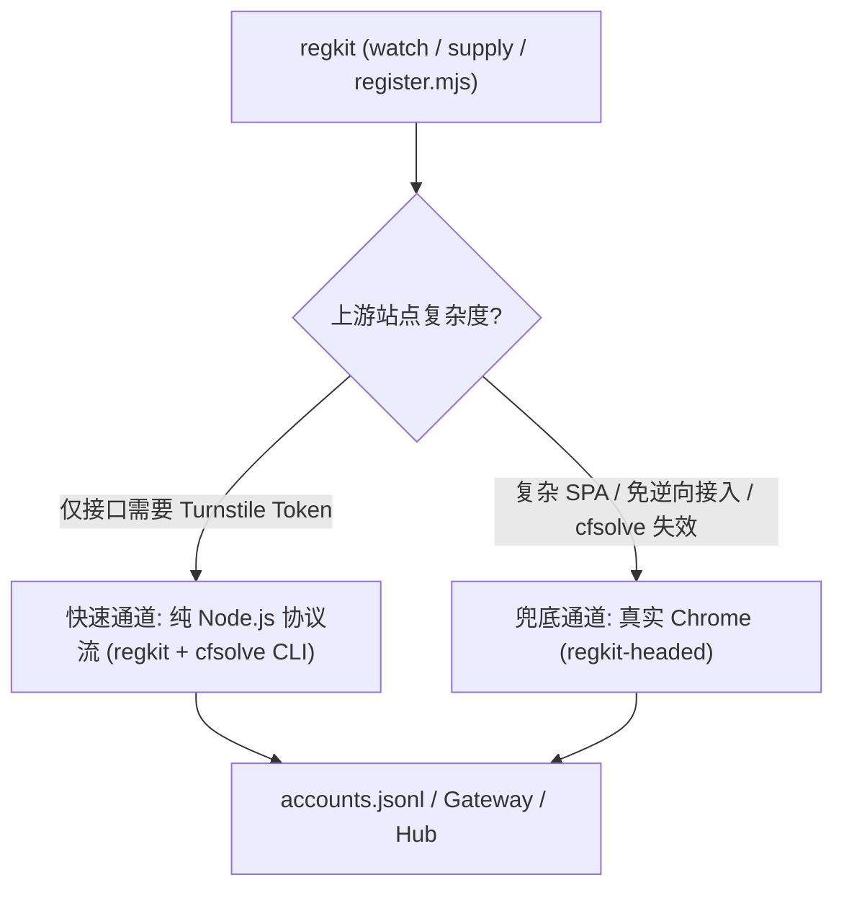

# Roadmap: 引入纯协议级无头 Turnstile 求解器 (`cfsolve`) 与双擎融合架构

本文档评估将 [chris124567/cfsolve](https://github.com/chris124567/cfsolve) 融入 `regkit` + `regkit-headed` 体系的可行性、技术边界与落地规划。

---

## 1. 背景与核心结论

`regkit-headed` 当前的核心存在价值，是为了解决目标站点因接入 Cloudflare Turnstile / Challenge 导致纯 HTTP 重放（`regkit` 的 `protocol.mjs`）和常规无头浏览器被拒的问题。

`chris124567/cfsolve` 提供了比传统“无头浏览器（Headless Browser）”更彻底的方案——**完全不启动浏览器的纯协议级（Request-based / Full Reverse）求解器**：
- **运行时 100% 全自动**：无需人工点击或介入，直接通过低层网络请求与内置 VM 算出 **Turnstile Token** 或 **`cf_clearance` Cookie**。
- **架构互补**：它能将“仅接口需要 Turnstile Token、但业务协议本身简单”的上游站点，从被迫使用 Python + 真 Chrome（`regkit-headed`）重新拉回 `regkit` 原生的纯 Node.js 协议流中，同时保留 `regkit-headed` 作为复杂 SPA 免逆向通道与容灾兜底（Fallback）。

---

## 2. 两条技术路线对比

| 维度 | `regkit-headed`（现有方案） | `chris124567/cfsolve`（新方案） |
| :--- | :--- | :--- |
| **实现原理** | **真实 Chrome 后台化**：通过 `open -n -g` + 反节流参数 `BG_ARGS` 拉起真实浏览器，利用 CDP 注入 `TURNSTILE_PATCH_JS` 修补 `MouseEvent.screenX/Y` 并自动点击复选框 | **纯协议逆向（Full Reverse）**：用 Rust 直接拉取 CF 挑战脚本，在内存中完成 AST 反混淆并模拟执行字节码 VM，直接构造加密 Payload 换取 Token |
| **核心技术栈** | Python + DrissionPage + macOS Google Chrome | Rust + 打补丁的 BoringSSL（伪装 TLS 指纹）+ `swc`（JS 反混淆）+ 自研 VM 解释器 + 预录制设备指纹 Profile（如 `safari-26-ios.json`） |
| **运行环境** | 依赖 GUI 宿主环境（如 macOS 桌面）和完整 Chrome 进程 | **零浏览器 / 纯无头**：单一二进制或库，可直接跑在无 GUI 的 Linux 容器/服务器上，极低内存与 CPU 开销 |
| **输入与产物** | 在真实页面 DOM 中完成交互，由 `wait_turnstile` 返回 Token，并配合 `spy.py` 捕获页面内 `fetch/XHR` 响应 | 输入 `page_url`、`sitekey`（或挑战页 HTML）与 Profile，1~3 秒内直接输出 **Turnstile Token** 或 **`cf_clearance` Cookie** |

---

## 3. Token 获取机制：自动化 vs 手工维护

### 3.1 日常运行拿 Token：100% 全自动，零人工介入
运行时调用完全不需要人工干预（连点击复选框都在协议层模拟完成）。每次调用只需传入三个参数：
1. **`page_url`**：挂载 Turnstile 的页面地址（如 `https://auth.example.com/sign-up`）。
2. **`sitekey`**：目标站点的 Turnstile 公钥（`0x4AAAAAAA...`，通常在网页 `data-sitekey` 属性或前端配置接口中固定存在）。
3. **`fingerprint`**：浏览器环境 Profile 配置文件路径（仓库自带现成配置，如 `profiles/safari-26-ios.json`）。

调用示例：
```bash
cfsolve --page 'https://auth.example.com/sign-up' \
  --sitekey '0x4AAAAAA...' \
  --fingerprint profiles/safari-26-ios.json \
  --proxy 'http://127.0.0.1:8080' \
  /tmp/solve-debug
```

### 3.2 什么时候需要手工介入？（仅离线维护 Profile）
只有在 **Cloudflare 大版本更新探针导致现有 Profile 失效**，或需要**新增浏览器指纹模型**时，才需要离线介入一次：
- 启动 `cfsolve` 自带的 `capture-proxy` 中间人代理；
- 用真实设备/浏览器挂该代理访问一次验证页，录制解码后的环境测量数据并生成新的 `.json` Profile 文件；
- 生成后即可继续全自动批量运行。

---

## 4. 适用边界与优劣势评估

### 4.1 适合直接用 `cfsolve` 替代浏览器的场景
- **业务接口简单，仅差一个 Turnstile Token**：如果目标站点的注册/登录 API（如发送验证码、提交注册表单）很容易用纯 HTTP 重放，唯一阻碍是请求体需要带 `cf-turnstile-response`，`cfsolve` 可以 100% 替代 Chrome，实现纯无头高并发运行。

### 4.2 仍需保留 `regkit-headed` 的场景
1. **重度复杂的 SPA 前端流程**：`regkit-headed` 除了过 Turnstile，还顺带免去了逆向目标站点自身前端代码的工作（例如复杂的多步状态机、前端动态签名、加密参数等），直接用 `click_button_by_text` 操作 DOM + `spy.py` 截获内部 API 响应。若改用 `cfsolve`，目标站点自身的业务请求仍需手动逆向。
2. **对抗更新的稳定性兜底**：Cloudflare 经常更新挑战脚本的混淆结构与 VM 指令集。`cfsolve` 属于静态反混淆 + 模拟执行，一旦 CF 改动字节码或探针，需要更新 Profile 或 Rust 代码；而 `regkit-headed` 跑在真实 Chrome V8 与真实渲染管线中，抗更新生命力更强。

---

## 5. 融入 `regkit` + `regkit-headed` 的架构设计

`regkit` 的核心设计哲学是 **Node.js 零依赖 + 外部 CLI 契约交互**（例如 `regkit/mailbox` 通过调用外部 `cloud-mail` CLI 收取验证码，上游项目只需编写纯 HTTP 的 `src/protocol.mjs`）。

引入 `cfsolve` 后，整套体系将演进为**双引擎三层架构**：



### 5.1 在 `regkit` 侧：新增 `regkit/turnstile` 原生 CLI 包装器
仿照 `regkit/mailbox` 调用 `cloud-mail` CLI 的契约模式，在 `regkit/src/turnstile.mjs` 中用 Node.js 原生 `child_process.execFile` 封装 `cfsolve` 二进制调用（保持 `regkit` 零 npm 依赖）：

- **契约输入**：`{ pageUrl, sitekey, proxy, profile }`
- **契约输出**：`{ token, cfClearance, userAgent }`
- **上游 `src/protocol.mjs` 接入方式**：
  原本因 Turnstile 被迫用 Python 写的站点，现在可以直接在 `protocol.mjs` 的 `requestCode` / `submitRegistration` / `login` 中调用：
  ```js
  export async function requestCode(cfg, log, identity) {
    const { token } = await solveTurnstile({
      pageUrl: 'https://auth.example.com/register',
      sitekey: cfg.turnstileSitekey,
      proxy: cfg.proxy,
    });
    return httpPost('https://api.example.com/v1/signup', {
      email: identity.email,
      'cf-turnstile-response': token,
    });
  }
  ```
- **收益**：直接复用 `regkit` 现成的 `register.mjs`、`pacer`（AIMD 限速）、`mailbox` 和 `watch.mjs`（含需要过 Turnstile 的 `login` 余额刷新与 `supply` 自动补号），无需启动 Chrome。

### 5.2 在 `regkit-headed` 侧：封装无头求解原语与双擎自动降级
在 `regkit_headed/turnstile.py` 中扩展无头求解与混合模式支持：
1. **提供 Python 侧无头原语 `solve_turnstile_headless(page_url, sitekey, proxy=None)`**：
   方便现有的 Python 注册脚本在不改动整体结构的前提下，直接用 `cfsolve` + `fetch_otp` 跑纯 HTTP 流程，无需调用 `start_browser()`。
2. **页面内 Token 注入混合模式**：
   当真 Chrome 遇到极端情况卡在 Turnstile 复选框时，可调用 `cfsolve` 算出 Token 后直接通过 JS 注入页面 `input[name="cf-turnstile-response"]` 并触发回调。
3. **双擎容灾（Auto-Fallback）**：
   优先使用 `cfsolve` 纯协议无头通道；当检测到 `cfsolve` 因 Cloudflare 升级连续失败时，自动降级拉起 `regkit-headed` 真实 Chrome 完成注册，确保号池持续供应。

---

## 6. 关键落地注意事项

1. **代理出口 IP 强一致**：
   许多站点后端在调用 Cloudflare `/turnstile/v0/siteverify` 校验 Token 时会一并传入客户端 IP。传给 `cfsolve` 的 `--proxy` 必须与后续发送业务 HTTP 请求的代理出口 IP 完全一致（若使用动态旋转代理，需固定 Sticky Session）。
2. **`cf_clearance` 整页盾的指纹对齐**：
   - 若仅过内嵌 **Turnstile 组件**（获取 `cf-turnstile-response` token），通常只需保证代理 IP 一致，普通 Node `fetch` / Python HTTP 客户端即可直接提交。
   - 若目标是整站 **Cloudflare Challenge 页面**（获取 `cf_clearance` Cookie），后续业务请求的 **TLS 指纹（JA3/JA4）、HTTP/2 帧特征和 `User-Agent`** 必须与 `cfsolve` 所用 Profile 完全一致。

---

## 7. 演进计划 (Milestones)

- [ ] **Phase 1：编译与独立验证**
  - [x] 编译 `cfsolve` Release 二进制并准备默认 Profile（如 `safari-26-ios.json`）。本地产物：`../cfsolve/target/release/challenge`，profile 为 `../cfsolve/profiles/safari-26-ios.json`（须与其 `answers` 目录放在一起）。
  - [ ] 选取一个现有的带 Turnstile 上游站点，测试纯 CLI 获取 Token + HTTP 提交的通过率与耗时。2026-11-11 对 enclave（`router.enclave.ai/login`，sitekey `0x4AAAAAADo_sGx9Lbpp7iVl`，action `login`，`--blank-page`）试了两次：求解约 3.2s，`POST /login` 都进了 “Check your email” 页（隐藏的 security-check 文案还在，不能当失败）。cloud-mail 两侧都没收到验证码，注册没跑完，通过率仍算未测完。aisa 是 Clerk 整页流程，token 替换不了 headed。
- [x] **Phase 2：`regkit-headed` 集成无头原语**
  - 在 [`regkit_headed/turnstile.py`](regkit_headed/turnstile.py) 中新增 `solve_turnstile_headless()` 包装函数（通过环境变量 `RH_CFSOLVE_BIN` 与 `RH_CFSOLVE_PROFILE` 配置路径）。
  - 补充纯逻辑单元测试到 [`tests/test_pure.py`](tests/test_pure.py)。
- [ ] **Phase 3：`regkit` 原生 Node.js 集成与双擎切换**
  - [x] 在 `regkit` 中新增 `src/turnstile.mjs` 子模块（遵循 `cloud-mail` 的外部 CLI 调用风格）。
  - [ ] 将首个仅因 Turnstile 而使用浏览器的上游项目迁移至纯 Node.js `protocol.mjs`，并保留 `regkit-headed` 作为 Fallback。同上：还没有这样的上游项目。
